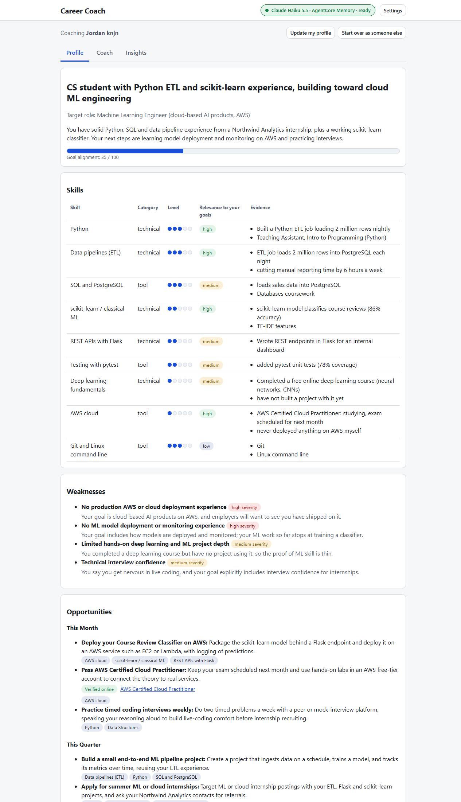

# Career Coach

An AI career coach you deploy into your own AWS account. Give it your resume, notes about your achievements and
your career goals. Claude Haiku 5.5 on Amazon Bedrock builds a profile of your skills, gaps and next steps, then
coaches you in a chat that remembers your progress through Amazon Bedrock AgentCore Memory. Built with Strands
Agents and a React site. One CloudFormation template creates everything; developers can also run it on a laptop,
including on a free open-source model (Qwen3, through Ollama) with no AWS account.


It was built for a Grace Hopper Celebration workshop.

| You want to | Read |
|---|---|
| Get ready before the workshop | [workshop/PREWORK.md](workshop/PREWORK.md) |
| Follow along step by step | [workshop/ATTENDEE-GUIDE.md](workshop/ATTENDEE-GUIDE.md) |
| Present it | [workshop/RUN-OF-SHOW.md](workshop/RUN-OF-SHOW.md) |
| See how it works | [docs/DESIGN.md](docs/DESIGN.md) and [docs/API.md](docs/API.md) |

## Deploy to your AWS account

Switch on Claude Haiku 5.5 once in the Amazon Bedrock console ([the prework](workshop/PREWORK.md) shows how). Then
in the CloudFormation console, in US East (N. Virginia) or US West (Oregon), create a stack from
[infra/career-coach.yaml](infra/career-coach.yaml) with your email and this repository's URL. It takes about 15
minutes; the stack's **CoachUrl** output is your coach, and AWS emails you a temporary password. Delete the stack
when you're done: the server and its NAT gateway are billed by the hour.

## Run it on your laptop

Sign in to AWS (`aws login`) and start the API in one terminal, checking that it reaches Claude:

```
cd backend
uv sync
uv run python scripts/set_model.py bedrock
uv run python -m coach
```

Start the website in a second terminal, then open http://127.0.0.1:5173:

```
cd frontend
npm install
npm run dev
```

To use the free local model instead, pull one (use `qwen3:1.7b` on a laptop with 8 GB of RAM or less), switch to
it, and restart the backend:

```
ollama pull qwen3:4b-instruct
uv run python scripts/set_model.py ollama
```

Run the tests with `uv run pytest` in `backend` and `npm test` in `frontend`.

## Add the AWS parts

From `backend`:

```
uv run python scripts/create_agentcore_memory.py   # long-term memory in Amazon Bedrock AgentCore Memory
uv run python scripts/deploy_amplify.py            # after "npm run build" in frontend: a public URL on AWS Amplify
```

Restart the backend after each one. Everything is pay-per-use: a workshop's worth costs a few cents for Claude and
well under one cent for memory, with the site usually inside the Amplify free tier. Clean up when you're done:

```
uv run python scripts/deploy_amplify.py --delete
uv run python scripts/create_agentcore_memory.py --delete
```

The API has no login and only listens on 127.0.0.1, so keep it on your own machine.

Licensed under MIT-0, see [LICENSE](LICENSE).


